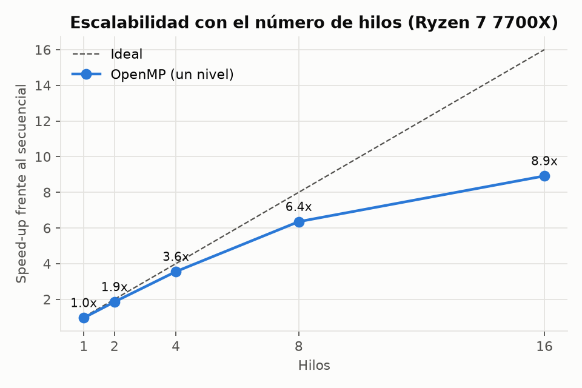
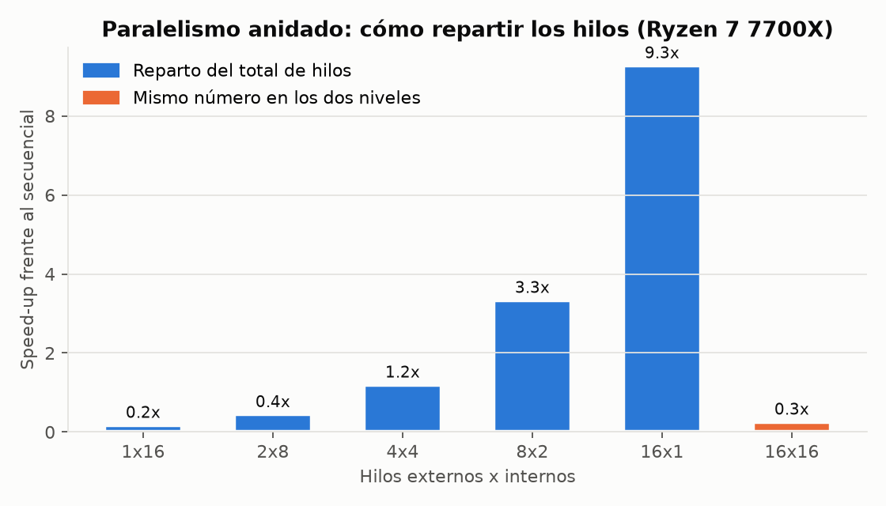
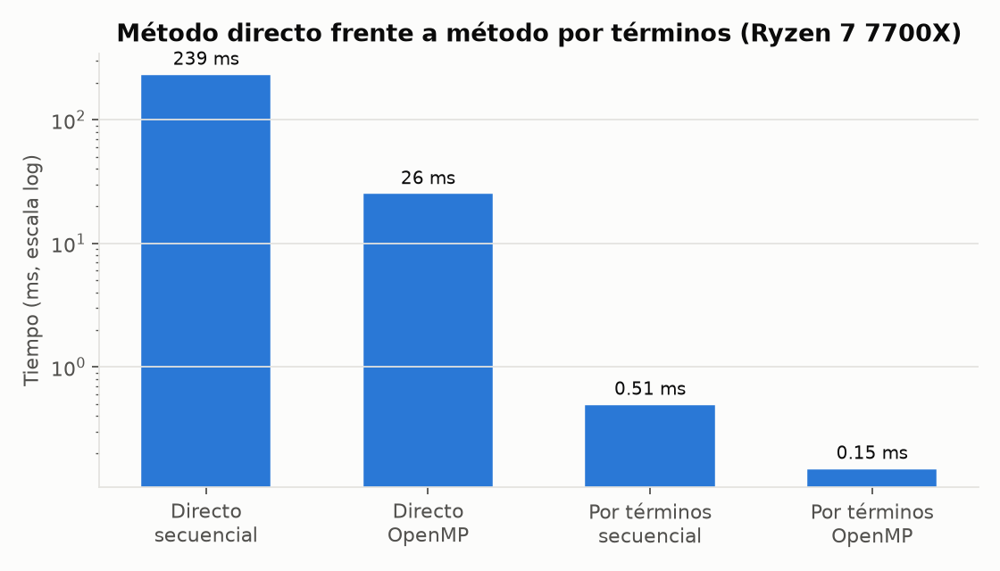
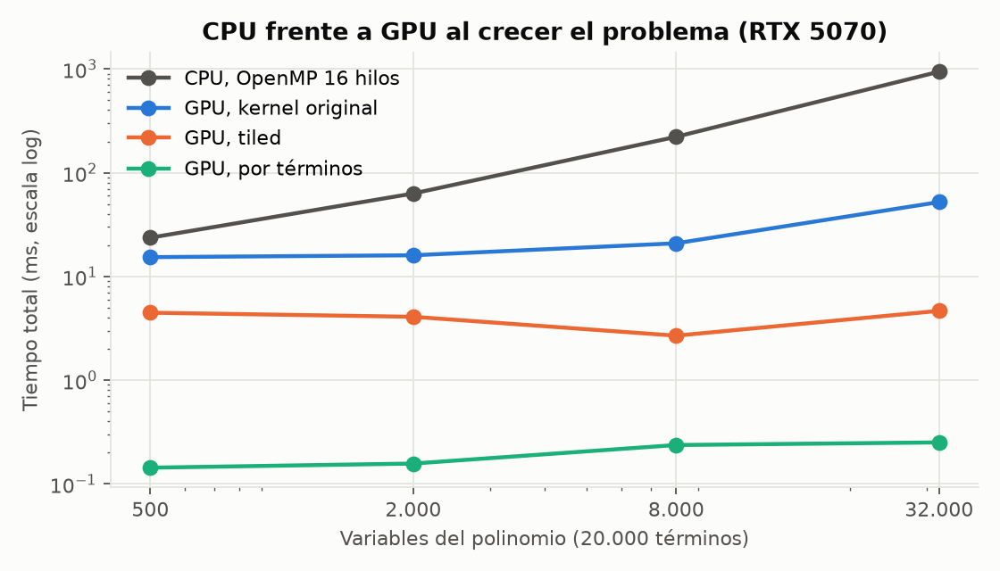
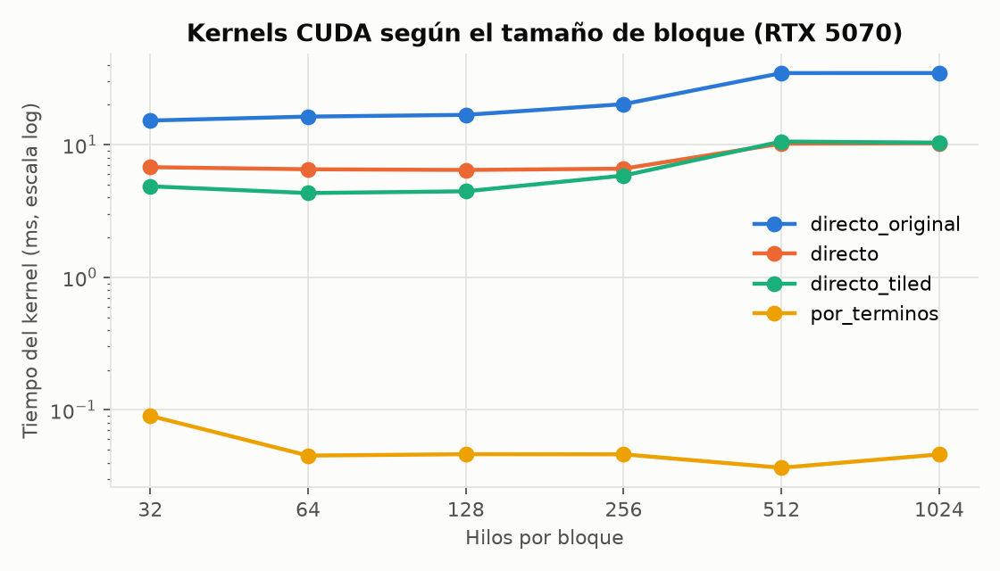
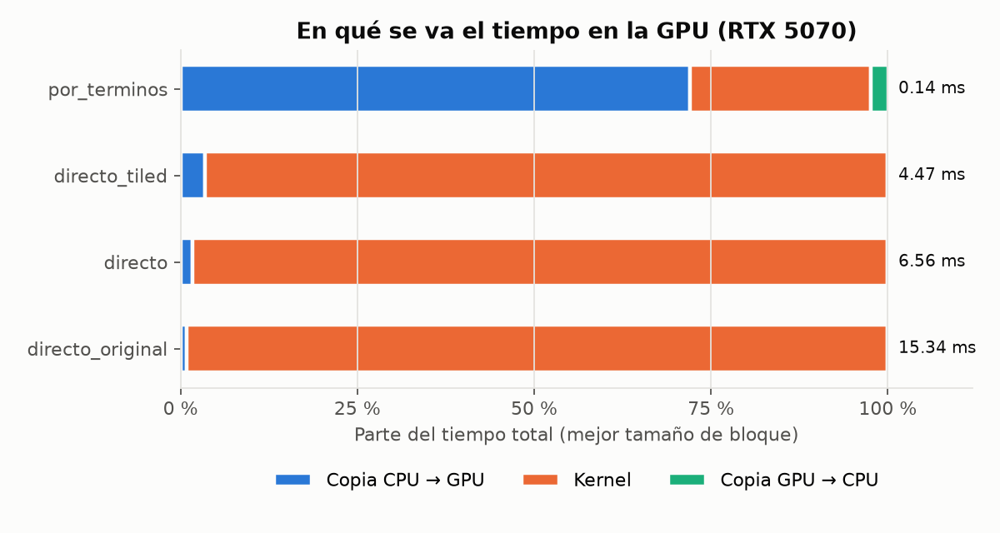

# Gradientes en paralelo: C, OpenMP y CUDA

Cálculo numérico del gradiente de funciones multivariables, y de la jacobiana de sistemas de ecuaciones, en versión secuencial, OpenMP y CUDA, con benchmarks reproducibles y validación contra la solución analítica.

[](https://github.com/alejandrorevillaEng/gradientes-paralelos/actions/workflows/ci.yml)
[](https://github.com/alejandrorevillaEng/gradientes-paralelos/actions/workflows/seguridad.yml)
[](LICENSE)

[](https://alejandrorevillaeng.github.io/gradientes-paralelos/)

Los resultados se pueden explorar en una [página interactiva](https://alejandrorevillaeng.github.io/gradientes-paralelos/) (`docs/index.html`), generada a partir de los mismos CSV con `python bench/pagina.py`.

## Por qué existe

Es la práctica final de Programación Paralela (Grado en Ingeniería Informática, UCAM, curso 2025-26). Calcular gradientes es la base del entrenamiento de redes neuronales y de casi cualquier método de optimización, y quería entender de verdad cuánto se gana repartiendo ese cálculo entre núcleos de CPU y miles de hilos de GPU. Al rehacerla para publicarla encontré errores en la versión entregada (el código no compilaba y el speed-up de CUDA estaba inflado unas cinco veces); los cuento en [docs/practica-original.md](docs/practica-original.md).

## Qué hace

- Gradiente por diferencias centradas de cualquier función `f: R^n -> R` (secuencial y OpenMP) y versiones específicas para polinomios de miles de términos.
- Dos formas de calcularlo: la directa, que evalúa el polinomio entero 2n veces, y una por términos, que aprovecha que f es una suma y solo toca los términos que contienen cada variable.
- Paralelismo de un nivel y anidado, con todos los repartos de hilos entre el bucle externo y el interno.
- Cuatro kernels CUDA, con memoria fijada, desglose de tiempos (copias y kernel) y barrido de tamaños de bloque.
- Sistemas de ecuaciones polinómicas: jacobiana en paralelo y Newton-Raphson amortiguado con eliminación gaussiana. Resuelve el sistema de ejemplo del enunciado.
- Validación de cada resultado frente al gradiente analítico y CSV con todas las medidas.

## Stack y decisiones técnicas

| Pieza | Tecnología | Por qué |
|---|---|---|
| Cálculo | C11 | Lo pedía la asignatura y deja ver el coste real de cada acceso a memoria |
| CPU | OpenMP | Paraleliza bucles con directivas; la reducción de arrays (`reduction(+:grad[0:n])`) evita los `atomic` en el método por términos |
| GPU | CUDA (C++17) | Los polinomios van en arrays planos para copiarlos con un `cudaMemcpy` por array y que los hilos lean posiciones contiguas |
| Compilación | CMake | Detecta OpenMP y, si hay `nvcc`, compila también la versión CUDA para la GPU de la máquina |
| Gráficas | Python y matplotlib | Se generan siempre a partir de los CSV, así cualquiera puede repetirlas con sus propios datos |

Los datos de prueba salen de un generador propio (splitmix64) con semilla fija, porque `rand()` no da la misma secuencia en Linux y en Windows. Los tiempos usan un reloj de alta resolución y la mediana de varias repeticiones; si una ejecución dura menos de 50 ms se repite en bucle para no medir solo el ruido del reloj.

## Resultados en CPU



Medidos en un AMD Ryzen 7 7700X (8 núcleos, 16 hilos) con GCC 16 en Windows, 500 variables y 20.000 términos, mediana de 5 repeticiones. Los datos están en [resultados/](resultados/).

| Hilos | 1 | 2 | 4 | 8 | 16 |
|---|---|---|---|---|---|
| Tiempo (ms) | 245 | 127 | 66 | 37 | 26 |
| Speed-up | 0,96x | 1,86x | 3,55x | 6,35x | 8,92x |

Escala casi linealmente hasta los 8 núcleos físicos. De 8 a 16 hilos gana bastante menos (de 6,4x a 8,9x) porque los hilos 9 a 16 comparten núcleo con los primeros (SMT). Con problemas más grandes el speed-up con 16 hilos sube de 9,5x (20.000 términos) a 11,1x (160.000), porque el coste de crear y sincronizar los hilos pesa menos.



El paralelismo anidado no compensa en este problema. Cada hilo externo abre un equipo nuevo para cada una de las 1.000 evaluaciones del polinomio, y eso cuesta más que lo que se gana repartiendo la suma. Cuantos más hilos internos, peor: 16×1 da 9,3x y 1×16 da 0,17x (más lento que el secuencial). Usar 16 hilos en cada nivel (256 en total, lo que pasaba sin querer en la versión original) se queda en 0,26x.



El cambio de algoritmo gana mucho más que el paralelismo: el método por términos tarda 0,51 ms en secuencial, unas 470 veces menos que el directo, porque cada término tiene como mucho 3 variables y solo se recalcula donde cambia algo. Con 16 hilos baja a 0,15 ms. Además es más preciso (error relativo 9e-11 frente a 2e-9), porque no resta dos sumas enormes.

En sistemas de 200 ecuaciones con 100 términos por ecuación, la jacobiana tarda 21,3 ms en secuencial, 3,7 ms con OpenMP y 0,15 ms por términos. Newton converge en 3 iteraciones con un residuo de 1e-13.

## Resultados en GPU

Medidos en una NVIDIA GeForce RTX 5070 (Blackwell, 48 SM, 12 GB) con CUDA 13.3 en WSL2 (Ubuntu 24.04), mediana de 7 repeticiones. Las referencias de CPU de esta sección son del mismo equipo y el mismo Linux: 134,5 ms en secuencial y 23,6 ms con OpenMP y 16 hilos. Los datos están en [resultados/gpu_rtx5070.csv](resultados/gpu_rtx5070.csv).

| Kernel | Idea | Tiempo total | Frente al secuencial | Frente a OpenMP |
|---|---|---|---|---|
| `directo_original` | El de la práctica: un hilo por variable que suma f(x+h) y f(x−h) sobre todos los términos | 15,3 ms | 8,8x | 1,5x |
| `directo` | Igual, pero solo suma la diferencia de los términos que contienen la variable | 6,6 ms | 20x | 3,6x |
| `directo_tiled` | El anterior cargando los términos por bloques en memoria compartida | 4,5 ms | 30x | 5,3x |
| `por_terminos` | Un hilo por término que suma su aportación con `atomicAdd` | 0,14 ms | ≈940x | ≈165x |

El tiempo total incluye las copias entre CPU y GPU, y todos los resultados se comparan con el gradiente analítico. Los kernels nuevos dan un error relativo de 8e-11, frente al 2e-9 del original.



Con 500 variables la GPU está casi vacía: el kernel original lanza 500 hilos para 48 multiprocesadores. Al subir a 32.000 variables el tiempo de OpenMP crece en proporción (de 24 a 940 ms) y el de la GPU apenas se mueve, porque por fin hay hilos para llenarla: el kernel con tiling resuelve las 32.000 variables en 4,7 ms, unas 200 veces menos que la CPU con 16 hilos.



Por el mismo motivo, con 500 variables van mejor los bloques pequeños: con bloques de 512 o 1.024 hilos todo cabe en un solo bloque, trabaja un único multiprocesador y el tiempo se duplica.



En el kernel por términos el cálculo dura 0,04 ms y la copia de los datos a la GPU tarda más que el propio cálculo. Lo mismo pasa con la jacobiana de un sistema de 2.000 ecuaciones: el kernel tarda 0,11 ms, pero devolver la matriz de 32 MB a la CPU cuesta 2,3 ms, y en total la GPU (3,5 ms) pierde frente a OpenMP. Para que compense, el resultado tendría que quedarse en la GPU (por ejemplo, resolviendo allí también el paso de Newton).

Como referencia, la versión original medida en el laboratorio de la universidad (RTX 2080 Ti) tardaba 15,96 ms, prácticamente lo mismo que en la RTX 5070: el cuello de botella era el diseño del kernel, no la tarjeta. Para repetir las medidas sin GPU propia está [notebooks/benchmark_cuda_colab.ipynb](notebooks/benchmark_cuda_colab.ipynb), que lo hace todo en Google Colab. En GitHub Actions solo se comprueba que compila, porque los runners no tienen GPU.

## Cómo ejecutarlo

Requisitos: CMake 3.24 o superior y un compilador de C con OpenMP (GCC o Clang con libomp). CUDA es opcional; en Windows lo más sencillo es WSL2 con Ubuntu y el paquete `cuda-toolkit` del repositorio de NVIDIA para WSL, que usa el driver de Windows.

```bash
git clone https://github.com/alejandrorevillaEng/gradientes-paralelos.git
cd gradientes-paralelos
cmake -S . -B build -DCMAKE_BUILD_TYPE=Release
cmake --build build
```

```bash
./build/gradbench --experimento todo --csv resultados/mi_cpu.csv
./build/sistema_demo
./build/gradbench_cuda --csv resultados/mi_gpu.csv     # solo si se ha compilado con CUDA
```

`gradbench --help` lista las opciones (variables, términos, lista de hilos, repeticiones, semilla). Para las gráficas:

```bash
pip install -r bench/requirements.txt
python bench/graficas.py --cpu resultados/mi_cpu.csv --gpu resultados/mi_gpu.csv
```

## Tests

```bash
ctest --test-dir build --output-on-failure
```

Comprueban el ejemplo del enunciado (∇f(1, 2, 3) = (8, 15, 8)), polinomios con exponentes, una función que no es un polinomio (Rosenbrock), que todas las versiones paralelas coinciden con el gradiente analítico, la eliminación gaussiana con pivoteo y que Newton resuelve el sistema del enunciado y uno aleatorio de 40 ecuaciones. En CI se compila con GCC y con Clang y los avisos cuentan como errores.

## Estructura

```
include/ y src/   biblioteca: polinomios, gradientes, sistemas y Newton
src/main_*.c      gradbench (benchmarks) y sistema_demo
cuda/             kernels y benchmark de GPU
tests/            tests de la parte de CPU
bench/            gráficas a partir de los CSV
notebooks/        benchmark de CUDA en Google Colab
resultados/       CSV y salida de las mediciones
```

## Autor

Alejandro Revilla Blanco

## Licencia

[MIT](LICENSE)
