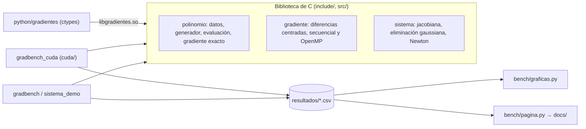

# Arquitectura y decisiones

## Piezas

Toda la lógica está en la biblioteca. Los ejecutables solo leen opciones, miden y escriben CSV, y las gráficas y la página se generan siempre a partir de esos CSV: ningún número del README está escrito a mano sin un fichero de resultados detrás.

## Decisiones

### Polinomio en arrays planos

- Contexto: la versión entregada guardaba cada término como una estructura con punteros. Copiar eso a la GPU exige una copia por término.
- Decisión: cuatro arrays (`coef`, `num_factores`, `var`, `exp`) con un máximo de 4 factores por término, al estilo CSR.
- Consecuencias: cuatro `cudaMemcpy` para todo el polinomio, accesos contiguos en la GPU y la misma estructura desde Python con `ctypes`. A cambio, un término no puede tener más de 4 variables; para estos problemas sobra.

### Generador propio con semilla

- Contexto: `rand()` no da la misma secuencia en Windows, Linux y la GPU, así que los resultados no se podían comparar entre máquinas.
- Decisión: splitmix64, que son cuatro líneas.
- Consecuencias: el mismo polinomio en cualquier plataforma, también desde Python (`Polinomio.aleatorio(..., semilla=7)`).

### Validar siempre contra el gradiente exacto

- Contexto: la práctica original solo medía tiempos. Un kernel rápido que da un resultado incorrecto no sirve.
- Decisión: cada medida calcula también el gradiente analítico y guarda el error relativo en el CSV.
- Consecuencias: así salió a la luz que el método por términos, además de rápido, es más preciso (9e-11 frente a 2e-9), y que FP32 no es una opción aquí.

### Método por términos

- Contexto: el método directo evalúa el polinomio entero 2n veces, aunque cada término solo dependa de 3 variables.
- Decisión: la diferencia centrada de una suma es la suma de las diferencias, y un término sin x_i aporta cero. Se recorre cada término una vez y se suma su aportación a sus variables.
- Consecuencias: unas 470 veces menos trabajo en secuencial. En OpenMP se usa una reducción de arrays para no pagar `atomic`. En la GPU, `atomicAdd`, porque las colisiones son raras.

### Medir con mediana y duración mínima

- Contexto: con el reloj de Windows, una medida de 0,1 ms es casi todo ruido.
- Decisión: mediana de varias repeticiones y, si una ejecución dura menos de 50 ms, repetirla en bucle y dividir.
- Consecuencias: tiempos estables entre ejecuciones. En la GPU se usan `cudaEvent` y se separan las copias del kernel.

### Bindings con ctypes en vez de una extensión de C

- Contexto: quería poder usar la biblioteca desde Python (notebooks, comparar con NumPy) sin añadir una cadena de compilación de extensiones.
- Decisión: la misma biblioteca compilada como compartida y un módulo de Python que declara las firmas con `ctypes`. La validación de entradas se hace en Python y, además, en C (índices de variable fuera de rango).
- Consecuencias: cero dependencias. El coste es que los datos se copian a arrays de `ctypes` en cada llamada; para gradientes de miles de variables es despreciable frente al cálculo.

### FP64 en la GPU

- Contexto: las GeForce tienen pocas unidades de doble precisión y FP32 parecía la optimización obvia.
- Decisión: medirlo antes de cambiar nada (experimento `precision` de `gradbench_cuda`).
- Consecuencias: mismo tiempo, porque el kernel está limitado por recorrer términos y no por la aritmética, y error de 4·10⁻⁶ en el mejor caso frente a 8·10⁻¹¹. Se queda en FP64.

## Calidad

| Comprobación | Dónde | Qué detecta |
|---|---|---|
| GCC y Clang con `-Wall -Wextra -Wpedantic -Werror` | CI | Código que solo compila en un compilador o con avisos |
| AddressSanitizer + UBSan | CI, `cmake --preset sanitizers` | Lecturas fuera de rango, memoria sin liberar, desbordamientos de enteros |
| cppcheck | CI | Variables sin inicializar, fugas y errores de portabilidad |
| Cobertura con gcov | CI, mínimo 85 % de líneas | Código sin probar |
| Tests de Python | ctest | Que los bindings y la biblioteca dicen lo mismo |
| Compilación CUDA | CI (sin GPU) | Que el código de GPU no se rompe aunque no se pueda ejecutar en CI |
| gitleaks, semgrep, osv-scanner | CI de seguridad | Secretos, patrones peligrosos y dependencias vulnerables |
